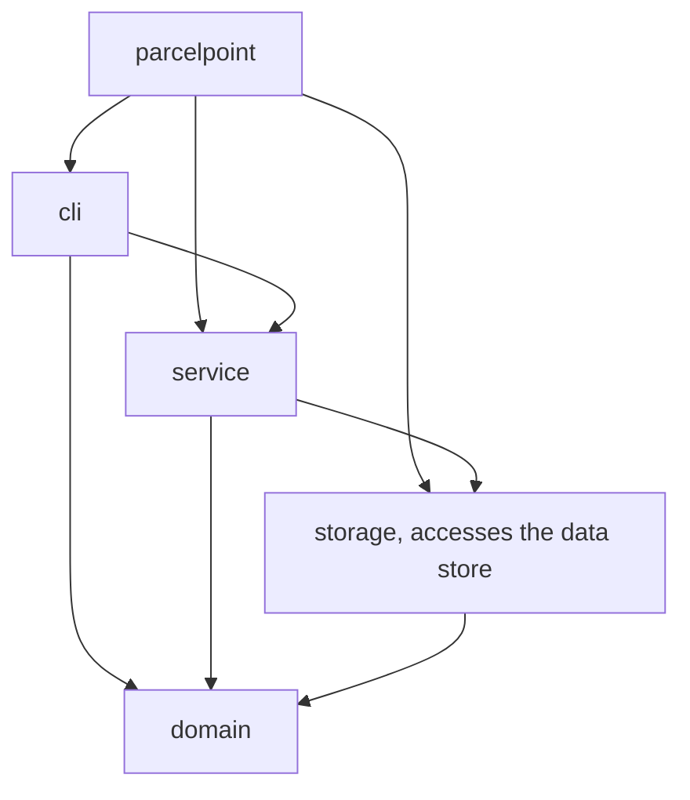
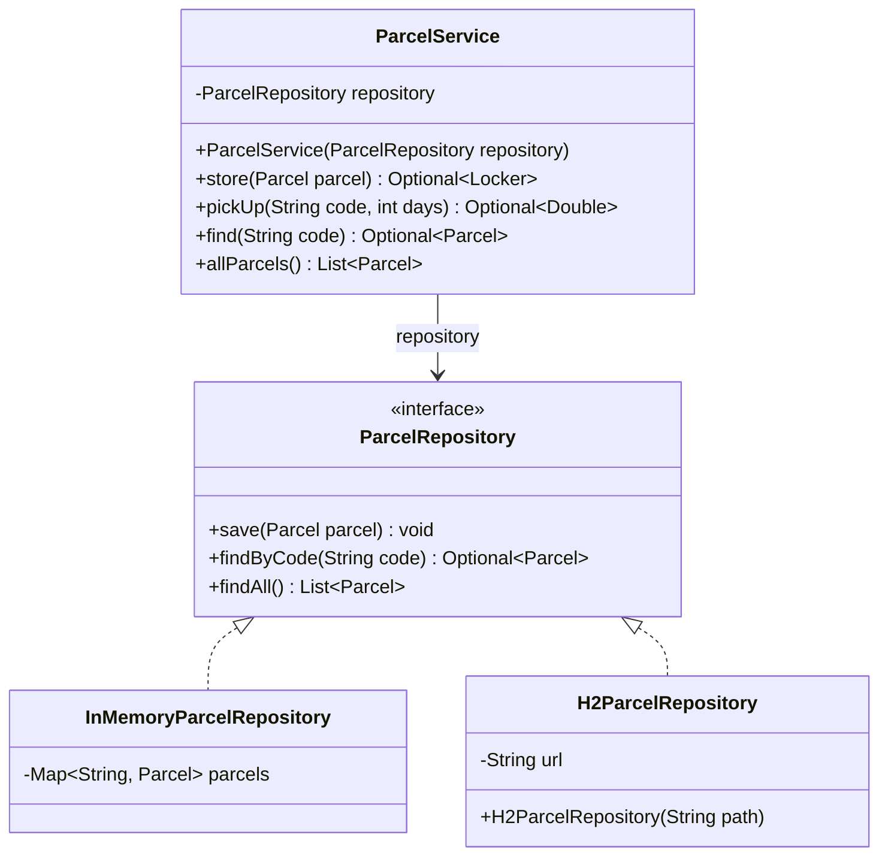
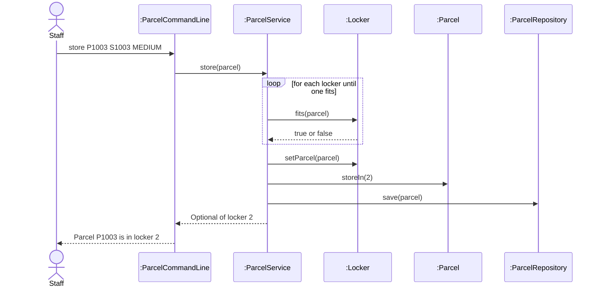

# Lab Report, Designing the Data Management Layer with H2

Repository URL: https://github.com/Pimarla/itcs382-h2-lab

## Tools

| Item | Version or name |
| --- | --- |
| JDK | 24.0.1 |
| Maven | 3.10.0 |
| IDE | Visual Studio Code 1.144.0 |
| AI tool and exact model, if you used one | Claude Opus 5.5 (Anthropic) |

## Part 0. From a store in memory to H2

Commit of the starter, before any change: 2c51e01

0.3 Your prediction for `staff`, written before the second run: I think `staff` will show no parcels and "Free lockers: 3", because the program might keep the parcels only while it is running.

Output of the second run, for `staff` and `quit`:

```text
> staff
Free lockers: 3
> quit
```

State in one sentence where you think the parcels of the first run were kept.

0.5 The line of Main that you would change to keep the parcels somewhere else:

```java
ParcelRepository repository = new InMemoryParcelRepository();
```

0.6 Commit of the switch to H2: 9aac687

0.7 Output of `SELECT * FROM PARCEL;` after you stored two parcels:

```text
sql> SELECT * FROM PARCEL;
CODE  | STUDENT_ID | PARCEL_SIZE | STATUS | LOCKER_NUMBER
P1001 | S1001      | SMALL       | STORED | 1
P1002 | S1002      | LARGE       | STORED | 3
(2 rows, 88 ms)
```

0.8 Explain why ParcelPoint could not start while the H2 Shell was open, and identify the class that wrote the message `Cannot create the PARCEL table`.

ParcelPoint could not start because H2 is an embedded database: the H2 Shell had already opened data/parcelpoint, so H2 locked the file parcelpoint.mv.db and a second program could not open it at the same time. The message "Cannot create the PARCEL table" was written by the constructor of H2ParcelRepository, which caught the SQLException from H2 and threw an IllegalStateException with that message.

0.9 Explain why `staff` shows no parcel while `find` shows each one, and why all three lockers look free.

`find` uses findByCode, which really reads the PARCEL table, so it finds each parcel. `staff` uses findAll, which is not written yet and only returns an empty list (List.of()), so it shows no parcel. When the program starts, the constructor of ParcelService calls findAll to put the waiting parcels back into their lockers; because the list is empty, no locker gets a parcel, so all three lockers look free.

0.11 Your findAll method:

```java
 @Override
    public List<Parcel> findAll() {
        // TODO Step 0.11: read every row of the PARCEL table as findByCode does,
        // TODO turn each row into a Parcel with toParcel, and return the list.
        String sql = "SELECT * FROM PARCEL ORDER BY CODE";
        List<Parcel> parcels = new ArrayList<>();
        try (Connection connection = connect();
             PreparedStatement statement = connection.prepareStatement(sql);
             ResultSet row = statement.executeQuery()) {
            while (row.next()) {
                parcels.add(toParcel(row));
            }
        } catch (SQLException e) {
            throw new IllegalStateException("Cannot read the parcels", e);
        }
        return parcels;
    }
```

Commit that adds findAll: c4a6477

0.12 Output of `SELECT * FROM PARCEL;` after the pickup:

```text
sql> SELECT * FROM PARCEL;
CODE  | STUDENT_ID | PARCEL_SIZE | STATUS    | LOCKER_NUMBER
P1001 | S1001      | SMALL       | PICKED_UP | null
P1002 | S1002      | LARGE       | STORED    | 3
(2 rows, 26 ms)
```

0.13 Optional. Describe what `find P9999'OR'1'='1` showed 

while the SQL was joined from strings, and what it showed after you put the placeholder back.
While the SQL was joined from strings, `find P9999'OR'1'='1` showed parcel P1001 (P1001, S1001, SMALL, PICKED_UP), although no parcel has that code. The quotes I typed closed the text in the SQL and added the condition '1'='1', which is true for every row, so H2 returned all rows and findByCode showed the first one. This is SQL injection. After I put the placeholder ? and statement.setString(1, code) back, the same input showed "No parcel with code P9999'OR'1'='1", because H2 compared CODE with the whole text I typed.

## Part A. Model the design

A1 Complete the flowchart with one node for each package and one arrow for each dependency, from the package that uses to the package that is used. Mark the package that accesses the data store.



State whether cli depends on storage, and explain why.

No, cli does not depend on storage. ParcelCommandLine imports only classes from domain and service, and it reaches the parcels only through ParcelService, so the presentation layer never touches the data management layer directly.

A2 Complete the class diagram of the data management layer with ParcelService, the interface ParcelRepository with its three operations, and the two classes that implement it.



A3 Draw a sequence diagram for the command `store P1003 S1003 MEDIUM`, from the staff member to the repository. Show each message as an operation of the class that receives it.



Explain why the last lifeline is the interface ParcelRepository rather than H2ParcelRepository.

ParcelService only knows its field of type ParcelRepository, the interface, and never names H2ParcelRepository. Main decides which class stands behind the interface (Dependency Inversion Principle), so the same diagram is true whether the program uses InMemoryParcelRepository or H2ParcelRepository.

## Part B. Design questions

1. Identify the files that you changed to move from the store in memory to H2, and explain why no other class had to change. Use the terms of this course.

I changed only Main.java (the line that creates the repository) and H2ParcelRepository.java (findAll). No other class changed because ParcelService depends on the interface ParcelRepository and receives it through its constructor, following the Dependency Inversion Principle. Only Main names the concrete class.

2. The PARCEL table stores the size of a parcel as SMALL, MEDIUM or LARGE rather than as 1, 2 or 3. Identify the type of connascence between ParcelSize and the table in each case, and explain which one is weaker.

Storing SMALL, MEDIUM, LARGE is connascence of name, because both sides must agree on the names. Storing 1, 2, 3 is connascence of convention, because both sides must agree on what each number means. Connascence of name is weaker, because the names are clear and easier to change safely.

3. Project Phase 2 asks for a data store that needs no separate server. Explain why an embedded database such as H2 meets this rule, and describe the limit of an embedded database that Step 0.8 showed.

H2 runs inside the program as a library and stores data in a file, so no separate server is needed. Step 0.8 showed its limit: only one program can open the database at a time, because H2 locks the file.

4. State the data store that you would choose for your Project Phase 2 team, files or an embedded database, the requirement that drives the choice, and the package that will access it.

We would choose an embedded database, H2, because [our system needs to search and update records by key]. The package storage will access it.

## AI usage declaration

| AI tool and exact model | Date | Purpose | Files or answers it produced or changed | How you checked its output |
| --- | --- | --- | --- | --- |
| Claude Opus 5.5 (Anthropic) | 14 Nov 2026 | Explain commands, code and errors | Helped write findAll and phrase my answers in Part 0 | Built and ran the program; outputs matched the lab sheet |
| Claude Opus 5.5 (Anthropic) | 14 Nov 2026 | Draft diagrams | A1, A2, A3 | Checked A1 against the imports; rendered all on mermaid.live |
| Claude Opus 5.5 (Anthropic) | 14 Nov 2026 | Draft Part B | Answers 1–3 | Shortened and edited the answers |
| | | | | |
